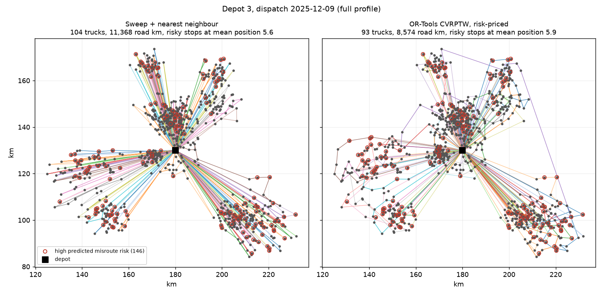

# fleet-routing-cvrp

[](https://github.com/kavya2693/fleet-routing-cvrp/actions/workflows/ci.yml)


Next-day routes for a 300-truck regional freight fleet: book drivers from a zone-level
demand forecast, route a few thousand time-windowed stops a day with OR-Tools, and find out
which lever actually cuts misrouted shipments in the pre-holiday peak.

## The problem

A regional freight operator runs about 300 trucks out of four depots and delivers about 2,200
orders on a normal weekday, closer to 2,700 in the weeks before the holidays. Every evening a
dispatcher has to turn tomorrow's orders into routes: which truck, which stops, in which order,
inside each customer's delivery window, without overloading a trailer or running a driver past
the end of the shift. Drivers were booked a week earlier, from whatever the demand forecast said.

Three things go wrong. Routes built by hand or by a simple sweep drive more kilometres than
they need to and miss delivery windows. A forecast that runs low in the peak books too few
drivers, and orders roll to the next day. And about 4% of shipments are misrouted: sorted to
the wrong depot, loaded on the wrong truck or dropped at the wrong door. In the peak that rises
past 5%, every one of them costs a second delivery and an unhappy customer.

## Why it is hard

The routing part is a solved problem in the textbook sense; the hard part is deciding what to
optimise and checking that the improvement is real. A solver that packs more stops onto each
truck saves kilometres, but a shipment at stop twelve sits deeper in the trailer than one at
stop two, so it can make misroutes worse. A misroute model can rank shipments by risk, but most
of the risk (a wrong postcode, a poor address, a zone halfway between two depots) is fixed before
the truck is loaded, and routing cannot touch it. The real question is where a risk score buys
anything.

## The approach

Three models feed one dispatcher, and one replay scores everything.

- **Zone demand forecast** per day for 40 zones, made every Monday for the next seven days
  (that is when drivers get booked). Seasonal naive, Holt-Winters ETS and SARIMA per zone, and
  one global XGBoost model on calendar and lag features. The forecast sets how many trucks each
  depot has the next week.
- **Misroute-risk classifier** (XGBoost, against logistic regression, a supervisor's rule and
  the generator's own ceiling) on facts known before dispatch.
- **CVRP with time windows** in OR-Tools, one solve per depot per day with a 6-second limit.
  Orders that do not fit roll over, at a drop penalty that grows each day the order has waited.

The key decision is how the risk score enters the router ([ADR-0001](docs/adr/0001-price-misroute-risk-by-route-position.md)).
Route position is kept out of the classifier, because the router decides it. Its effect is
estimated separately from history (0.094 extra log-odds per stop down the route), and each stop
is charged `misroute_cost_km x 0.094 x p(1-p)` for every position past the first: the expected
misroute cost of moving it one place later, in the same kilometres as the rest of the objective.
The baseline is a sweep dispatcher (fill trucks by angle around the depot, order stops by nearest
neighbour). Every number below comes from one replay function that drives the finished routes and
scores misroutes with the ground-truth hazard at the position each stop actually got.

## The result

Two replayed weeks (Monday to Friday order days, each dispatched the next day, leftovers carried
forward), four depots, 300 trucks. Full output: [`outputs/full/report.md`](outputs/full/report.md),
log: [`outputs/full/run_log.txt`](outputs/full/run_log.txt).

**The finding that matters most is the one I did not want.** The XGBoost misroute model is no
better than a two-line supervisor rule at the one job where a risk score clearly pays, and
pricing risk inside the router is a weak lever.

| Peak week (13,554 orders) | Sweep baseline | OR-Tools | OR-Tools, risk-priced |
|---|---:|---:|---:|
| Road km | 140,683 | 109,607 (-22.1%) | 113,938 (-19.0%) |
| Truck-days | 1,457 | 1,339 (-8.1%) | 1,370 (-6.0%) |
| Stops on time | 81.6% | 100% | 100% |
| Delivered next day | 91.4% | 94.9% | 95.1% |
| Mean lead time, days | 1.12 | 1.05 | 1.05 |
| Expected misroute rate | 4.41% | **4.58%** | 4.39% |

| Quiet week (10,840 orders) | Sweep baseline | OR-Tools | OR-Tools, risk-priced |
|---|---:|---:|---:|
| Road km | 105,490 | 88,698 (-15.9%) | 91,829 (-12.9%) |
| Truck-days | 1,058 | 1,018 | 1,059 |
| Stops on time | 79.9% | 100% | 100% |
| Expected misroute rate | 3.07% | 3.16% | 2.98% |

What this says:

1. **The solver beats the sweep on distance, trucks and windows**, by 16-22% on kilometres. The
   100% on-time figure is by construction: OR-Tools treats windows as hard and drops a stop
   rather than arrive late, so its cost shows up as rollovers instead (next-day share).
2. **The second metric moves the wrong way.** Plain OR-Tools misroutes *more* than the sweep
   (4.58% vs 4.41% in the peak), because tighter routes put more stops on each truck.
3. **Pricing risk inside the router recovers that, and not much more.** At a misroute cost of
   150 km it cuts the rate 4.2% relative to plain OR-Tools for 4.0% more kilometres. Raising the
   price does not help:

   | Misroute priced at | Peak misroute rate | Road km vs plain OR-Tools |
   |---:|---:|---:|
   | 0 km (off) | 4.58% | - |
   | 150 km | 4.39% | +4.0% |
   | 500 km | 4.32% | +7.7% |
   | 2,000 km | 4.33% | +18.4% |

   Reordering stops only changes *which* shipments sit deep in the trailer; it cannot make the
   trailer shallower. The only way to cut the position effect for everyone is shorter routes,
   which is more trucks.
4. **The lever that works is a phone call, and the model does not beat the rule at it.** If the
   dispatch office checks the top 5% of each day's consignees before loading (confirms the
   postcode, cleans the address, reprints a handwritten label), peak misroutes fall about 16%:

   | Top 5% ranked by | Peak misroute rate | Reduction |
   |---|---:|---:|
   | no checks | 4.39% | - |
   | random | 4.34% | 1.1% |
   | supervisor rule (postcode mismatch, then address quality) | 3.66% | **16.6%** |
   | logistic regression | 3.69% | 15.8% |
   | XGBoost | 3.67% | 16.4% |
   | ceiling (true pre-dispatch risk) | 3.68% | 16.1% |

   The rule ranks by exactly the faults a call can fix. The models rank by total risk, which
   also includes things a call cannot fix (a zone between depots, a cross-dock relabel), so they
   spend some calls on shipments the call will not help.
5. **Classifier quality is capped by the label.** ROC-AUC on the held-out last 20% of dates:
   XGBoost 0.645, logistic regression 0.647, rule 0.596, and the ceiling (the generator's true
   pre-dispatch log-odds) 0.647. Both models are already at the ceiling; misroutes are rare and
   noisy. XGBoost at depth 3-4 did worse (0.640, 0.633), so the shipped model uses depth 2.

**Forecasts and driver booking.** Rolling weekly origins over the last 12 weeks of 2025, 40 zones:

| Model | WAPE, all | WAPE, peak | Bias, peak | Depot-days short of trucks, peak | Idle truck-days, all |
|---|---:|---:|---:|---:|---:|
| Seasonal naive | 0.344 | 0.337 | -2.4% | 26.9% | 2,103 |
| Holt-Winters ETS | 0.260 | 0.260 | -9.6% | 53.8% | 1,922 |
| SARIMA(1,0,1)(0,1,1)7 | 0.262 | 0.259 | -8.5% | 48.1% | 2,169 |
| XGBoost, global | **0.208** | **0.204** | -3.1% | **8.7%** | **1,304** |

The classical models have a reasonable WAPE but run 8.5-9.6% low through the peak, so they book too
few trucks on half the peak depot-days. That bias, not the WAPE, is what a dispatcher feels.
The disappointing part: in the replay, booking drivers from the seasonal-naive forecast instead of
XGBoost changed the peak lead time by 0.001 days (1.051 vs 1.050). In the peak most depots were
booked at or near the full fleet either way, and a one-day rollover is all a short day costs.

**Fulfilment lead time** (order day to delivery, plus one day for each expected misroute) drops
from 1.12 to 1.05 days in the peak. It is measured from next-day dispatch at the depot, so it
leaves out linehaul between depots; it is not comparable with an end-to-end figure.



## How it works

```
seeded generator ──► zone demand (2 yrs) ──► weekly backtest ──► trucks booked per depot-day
                 ├─► shipment history ────► misroute classifier ─┐   position effect (beta)
                 └─► dispatch orders ───────────────────────────┬┴─► risk_slope = p(1-p)
                                                                 ▼
             for each order day:  orders + carried backlog ──► per-depot solve ──► replay
                                  (sweep | OR-Tools | OR-Tools + risk price)       │
                                  undelivered ◄── rollover, age +1 ◄───────────────┘
             after the window:    up to 3 clear-out days with the full fleet
```

- `data.py` builds the network, demand, history and orders, and holds the ground-truth hazard.
- `forecast.py` runs the four forecasters with weekly origins; every feature is at least a week
  old, so the whole week is predicted from the origin with no recursion.
- `risk.py` fits the classifier, estimates the position effect, and scores address checks.
- `routing.py` has the sweep, the OR-Tools model (capacity, time and position dimensions,
  disjunctions for droppable stops) and `replay`, which computes every routing metric.
- `simulate.py` books trucks, carries the backlog and summarises each arm.
- Stop conditions: each OR-Tools solve stops at its wall-clock limit (6 s full, 1.5 s small);
  a window stops when the backlog is empty or after three clear-out days.

## Running it

```bash
uv sync
make check        # ruff, format, mypy, pytest
make run-small    # one depot, 12 trucks, about a minute
make run          # 300 trucks, four depots; ~18 minutes on a laptop, writes outputs/full/
make data         # regenerate the full dataset only
docker build -t fleet-routing . && docker run --rm fleet-routing   # small profile
```

No API keys, model servers or downloads beyond the Python packages.

## The data

The dataset is generated by the seeded script `scripts/generate_data.py` (`make data`) and sized
to the production problem: 300 trucks, four depots, 40 zones, two years of daily zone demand,
200,000 historical shipments and about 24,000 dispatch orders across the two replayed weeks. The
production data is proprietary.

Built-in patterns: weekday and weekend shape, annual seasonality, growth, a pre-holiday peak
whose size differs by zone, public holidays with catch-up the next working day, bulk-order
outliers (0.3% of zone-days), and a gappy order feed (1.2% of zone-days missing plus a four-day
outage). Forecasts train on the gappy feed and are scored on the true counts. The misroute hazard
depends on address quality, postcode mismatch, new consignee, relabelling, handwritten labels,
zone position between depots, peak, express service and route position, with thresholds and an
interaction so that a linear model is not handed the answer.

## Tests

`make check` runs 16 tests. The two that matter most:

- `test_forecasts_do_not_look_past_the_origin` multiplies every observation from the forecast
  origin onwards by ten and checks that the naive, ETS and XGBoost forecasts made at that origin
  do not change. A leak there would flatter every forecast number above.
- `test_risk_pricing_moves_a_risky_stop_to_the_front` puts three stops on the corners of a
  square, where the far corner is second whichever way the truck goes round. With the risk
  term off it stays second; priced high, it goes first at the cost of a detour. That is the whole
  mechanism of ADR-0001 in one assertion.

The replay is tested on its own first, including against deliberately wrong plans (a late stop,
an overloaded truck), because every routing number depends on it. Other tests cover capacity and
shift limits for both planners, drop order by age, recovery of the position effect from history,
and that every order in a replayed window is delivered or counted as stranded.

## Known limitations

- **Biggest gap: the routing misroute result tests a mechanism I wrote into the generator.**
  Route position raises misroute risk because the generator says so (0.09 log-odds per stop).
  The pipeline recovers that effect from history and prices it correctly, but whether the effect
  exists, and how big it is, has to be measured on real route histories before any of the
  routing-side misroute numbers mean anything.
- The address-check result depends on assuming a call fixes the postcode, address and label
  faults completely. Real calls fail or go unanswered.
- OR-Tools stops on wall-clock time, so results vary a little run to run and with machine load
  (plain OR-Tools came in at 87,715 and 88,698 km on the quiet week in two runs). This machine was
  heavily shared during the run; six seconds per depot-day is far below what production would allow.
- Time windows are hard in OR-Tools and ignored by the sweep, so the on-time comparison is
  lopsided by design; rollovers carry OR-Tools' side of that trade.
- Distances are straight lines times 1.3 at a flat 50 km/h. No road network, traffic, driver
  breaks or multi-trip days. One order is one stop.
- Lead time starts at the depot; linehaul and cross-dock time are not modelled.
- No LSTM (the brief made it optional; ADR-0001 says why it was left out).
- The classifier and forecaster are retrained per run, not monitored for drift.

## Insights and learning

I picked this because route optimisation demos usually stop at "fewer kilometres", and the
operational question a dispatcher actually asks is what the routes do to service and errors.
Measuring misroutes next to kilometres is what made it interesting: the solver's best feature,
packing trucks tighter, is exactly what nudges misroutes up.

The surprise was the address-check table. I expected the classifier to beat the supervisor's
rule clearly, and it ties it, along with the true-risk ceiling. Once I looked at what the
intervention fixes, it made sense: a risk score is only as useful as its match to the action
it triggers. A model trained to predict *fixable* risk would be the honest next step.

What I got wrong at first: XGBoost's `min_child_weight` is in hessian units, so at a 4% base rate
a setting that looks small needs hundreds of rows per leaf. On the small profile the model quietly
stopped using the postcode-mismatch flag, its strongest feature, and the address-check table
exposed it because XGBoost suddenly saved nothing. I also expected the better forecast to show
up in lead time, and it did not, because the peak is capped by the fleet, not by the booking.

Next: estimate the position effect from real route histories before trusting it, train the risk
model on fixable faults only, and replace the 6-second solves with a longer limit and a warm start
from the previous day's routes.

## License

MIT
