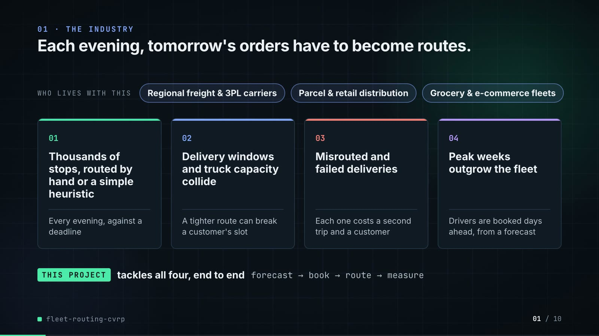
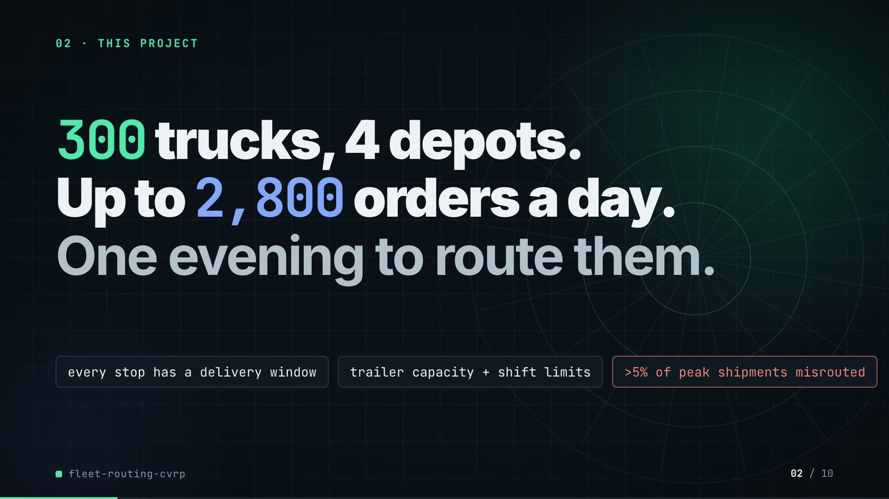
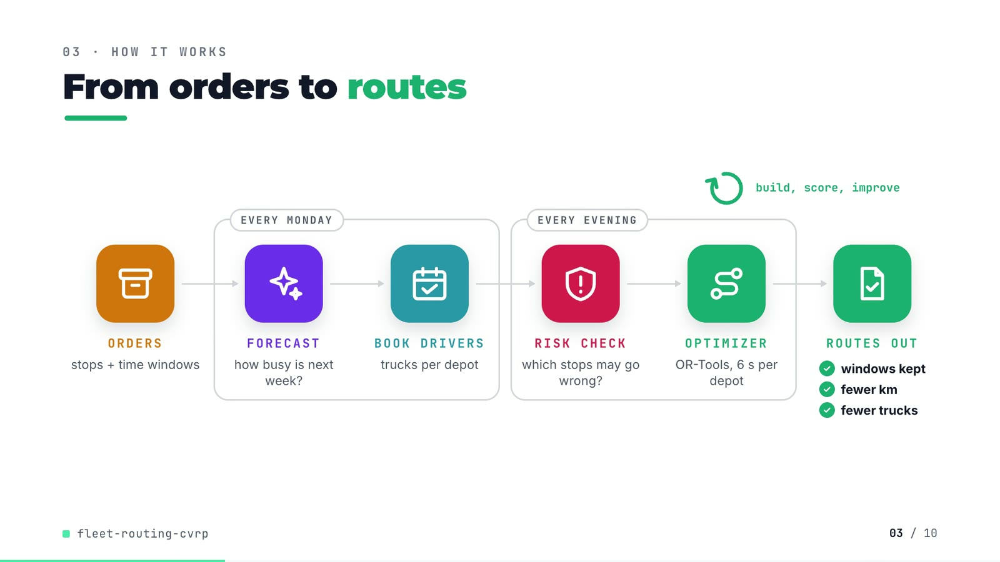
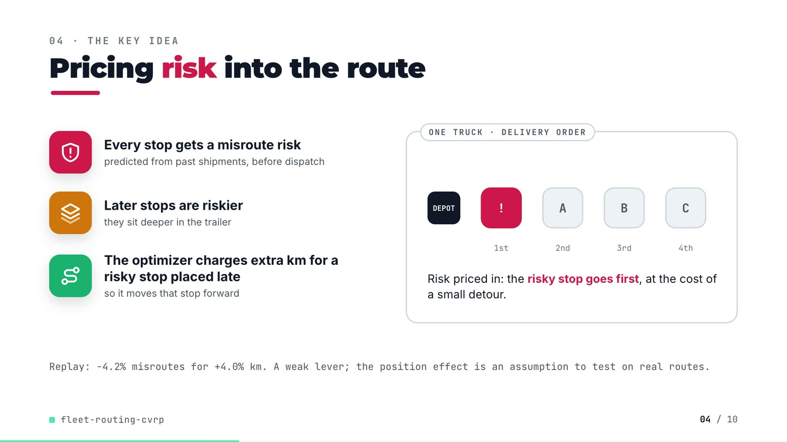
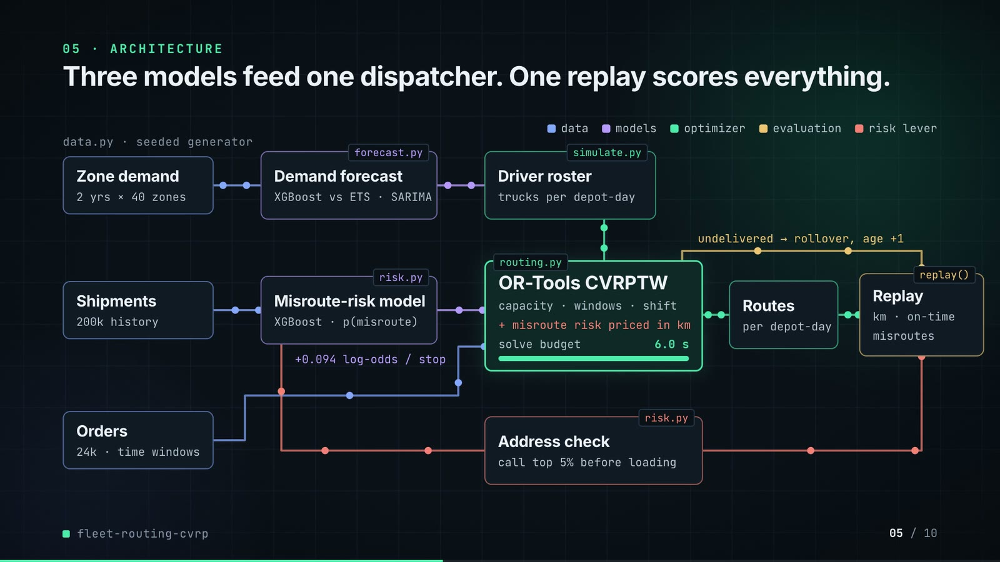
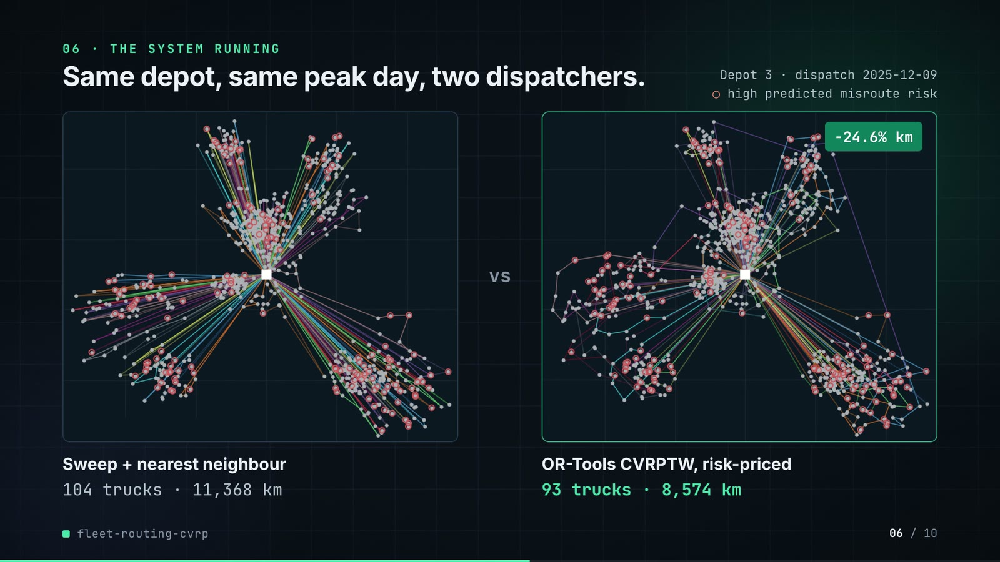
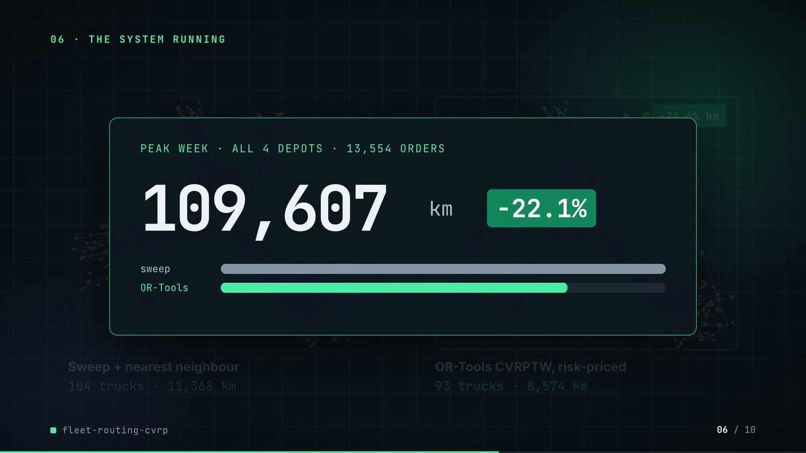
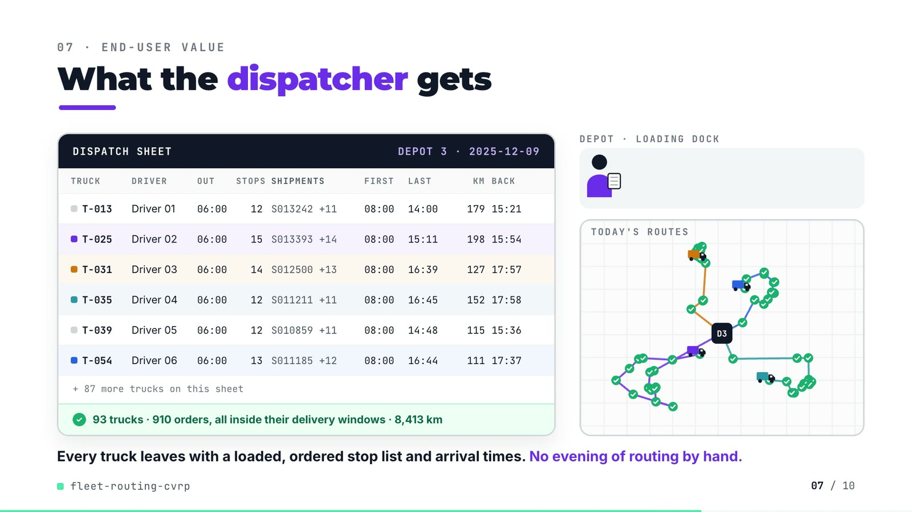
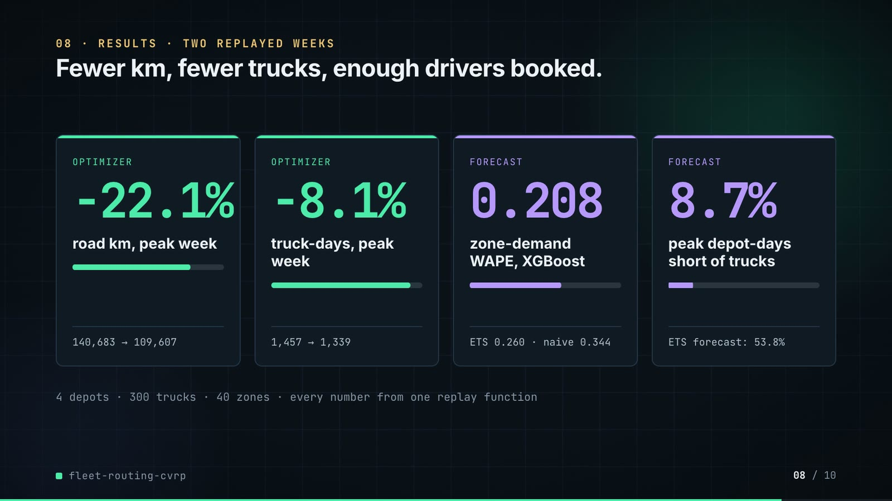
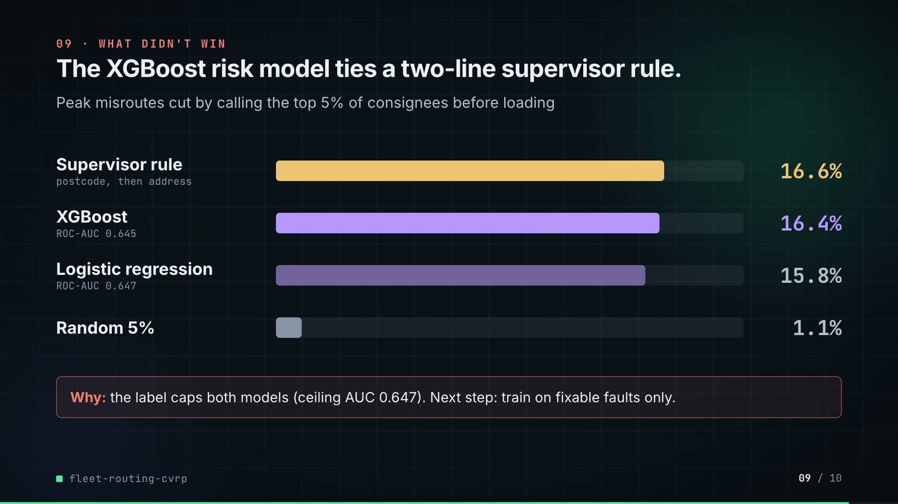

# fleet-routing-cvrp: demo video audit report

**Repository:** https://github.com/kavya2693/fleet-routing-cvrp  
**Numbers taken from commit:** `c9b3c09` (outputs last changed in `c9b3c09 (2026-10-13 21:56:42 +0400)`)  
**Video:** `docs/demo/demo.mp4` (84.0 s, 1920x1080, 30 fps, silent)  
**Generated:** 2026-10-14 13:44  
**Automated checks:** 52 pass · 0 fail · 4 manual (of 56 figures)

## How to use this report

Every number or claim on screen has an ID (`F-01`, `F-02`, ...) and every modelling assumption has an ID (`A-01`, ...). Cite the ID. Each figure lists its source file, the exact column/row/key, the formula for derived numbers, and an automated check result. The change-impact matrix tells you which slides and files change if an input or assumption changes.

Types: **direct** = read straight from a repo output; **derived** = computed from direct values (formula given); **illustrative** = drawing or example, not data; **general knowledge** = context not produced by the repo.

### Regenerate

```bash
make run                                   # outputs/full/*.csv, results.json, route_map.png (~18 min)
python3 docs/demo/source/tools/darkmap.py outputs/full/route_map.png docs/demo/source/assets
PYTHONPATH=src .venv/bin/python docs/demo/source/tools/export_dispatch_sheet.py docs/demo/source/assets/dispatch_sheet.json
python3 docs/demo/source/tools/inject_sheet.py docs/demo/source/assets/dispatch_sheet.json docs/demo/source/compositions/value.html --rows 12,24,30,34,38,53 --animate 24,30,34,53
cd docs/demo/source && npx --yes hyperframes@0.8.156 check && npx --yes hyperframes@0.8.156 render -f 30 -q looks -o renders/fleet-routing-cvrp-master.mp4 && cd -
ffmpeg -y -i docs/demo/source/renders/fleet-routing-cvrp-master.mp4 -c:v libx264 -preset slow -crf 25 -pix_fmt yuv420p -movflags +faststart -an docs/demo/demo.mp4
python3 docs/demo/source/tools/build_audit_report.py docs/demo/source/audit/facts.yaml   # stills, checks, MD/DOCX/PDF
```

## 1. Figures

| ID | Shown on screen | Slides | Source | Column / row / key | How computed | Type | Check |
|---|---|---|---|---|---|---|---|
| F-01 | 3 industry chips | 01 | `author's framing` | - | - | general knowledge | manual: Context statement, not a repo output. |
| F-02 | 4 problem cards | 01 | `README 'The problem' (problems 2-4)` | README lines 16-27 | - | general knowledge | ✓ verified |
| F-03 | 300 trucks | 02, 05, 08 | `outputs/full/results.json` | trucks | - | direct | ✓ verified |
| F-04 | 4 depots | 02, 08 | `outputs/full/results.json` | depots | - | direct | ✓ verified |
| F-05 | Up to 2,800 orders a day | 02 | `data/full/dispatch_orders.csv` | orders per date (max = 2,785 on 2025-12-08) | max daily order count = 2,785, rounded up to the nearest hundred = 2,800 | derived | ✓ verified |
| F-06 | every stop has a delivery window | 02 | `data/full/dispatch_orders.csv` | tw_start, tw_end (no missing values) | count of missing windows = 0 | direct | ✓ verified |
| F-07 | trailer capacity + shift limits | 02 | `src/fleet_routing/routing.py:202, :205` | capacity + time dimensions | - | direct | ✓ verified |
| F-08 | >5% of peak shipments misrouted | 02 | `outputs/full/risk_scores.csv; README line 26-27` | model=xgboost, period=peak, base_rate (0.0531) | base_rate x 100 = 5.3% > 5% | direct | ✓ verified |
| F-09 | OR-Tools, 6 s per depot / solve budget 6.0 s | 03, 05 | `outputs/full/results.json` | solver_seconds_per_depot_day | - | direct | ✓ verified |
| F-10 | EVERY MONDAY | 03 | `README line 43` | README | - | direct | ✓ verified |
| F-11 | windows kept / fewer km / fewer trucks | 03 | `outputs/full/routing_summary.csv` | arm in {sweep, ortools_risk}, window=peak: on_time_pct, total_km, vehicle_days | on_time_pct = 100; total_km(ortools_risk) < total_km(sweep); vehicle_days(ortools_risk) < vehicle_days(sweep) | derived | ✓ verified |
| F-12 | build, score, improve | 03 | `src/fleet_routing/routing.py:229-230` | PATH_CHEAPEST_ARC + GUIDED_LOCAL_SEARCH | - | direct | ✓ verified |
| F-13 | Later stops are riskier | 04 | `src/fleet_routing/data.py:238-241; outputs/full/results.json position_effect_logodds_per_stop` | 0.09 generated, 0.094 estimated | estimated slope > 0 | direct | ✓ verified |
| F-14 | -4.2% misroutes | 04 | `outputs/full/routing_summary.csv` | window=peak, misroute_pct: ortools_risk 4.3871, ortools 4.5810 | (4.3871 - 4.5810) / 4.5810 x 100 = -4.23% | derived | ✓ verified |
| F-15 | +4.0% km | 04 | `outputs/full/routing_summary.csv` | window=peak, total_km: ortools_risk 113,937.7, ortools 109,607.3 | (113,937.7 - 109,607.3) / 109,607.3 x 100 = +3.95% | derived | ✓ verified |
| F-16 | 2 yrs x 40 zones | 05, 08 | `data/full/zone_demand.csv; outputs/full/results.json zones` | 731 daily rows 2024-01-01..2025-12-31; zones = 40 | - | direct | ✓ verified |
| F-17 | 200k history | 05 | `data/full/shipments_history.csv` | row count | - | direct | ✓ verified |
| F-18 | 24k | 05 | `outputs/full/results.json` | dispatch_orders = 24,394 | 24,394 rounded to thousands | direct | ✓ verified |
| F-19 | +0.094 log-odds / stop | 05 | `outputs/full/results.json` | position_effect_logodds_per_stop | - | direct | ✓ verified |
| F-20 | forecast.py, risk.py, simulate.py, routing.py, replay(), data.py | 05 | `src/fleet_routing/` | files + def replay | - | direct | ✓ verified |
| F-21 | call top 5% before loading | 05, 09 | `src/fleet_routing/config.py:93` | ADDRESS_CHECK_SHARE = 0.05 | - | direct | ✓ verified |
| F-22 | Depot 3 · dispatch 2025-12-09 | 06 | `data/full/depots.csv (busiest depot); src/fleet_routing/cli.py:121-125; config peak window` | depot with most vehicles = 3; first peak dispatch = 2025-12-08 + 1 day | - | direct | ✓ verified |
| F-23 | 104 trucks | 06 | `outputs/full/route_map.png (left panel title)` | plot title | - | direct | manual: Read from the PNG title; the repo does not save per-depot-day routes. Cross-check: depot 3 fleet = 104 (depots.csv). |
| F-24 | 11,368 km | 06 | `outputs/full/route_map.png (left panel title)` | plot title | - | direct | manual: Read from the PNG title; not persisted in any CSV. |
| F-25 | 93 trucks | 06 | `outputs/full/route_map.png (right panel title); re-run in demo assets/dispatch_sheet.json` | trucks_used | - | direct | ✓ verified |
| F-26 | 8,574 km | 06 | `outputs/full/route_map.png (right panel title)` | plot title | - | direct | manual: Read from the PNG title. The single-day re-run (assets/dispatch_sheet.json) gives 8,412.7 km because the solver stops on wall-clock time (A-04). |
| F-27 | -24.6% km | 06 | `F-24, F-26 (plot titles)` | 8,574 vs 11,368 | (8,574 - 11,368) / 11,368 x 100 = -24.58% | derived | ✓ verified |
| F-28 | 13,554 orders | 06 | `outputs/full/routing_summary.csv` | arm=sweep, window=peak, orders | - | direct | ✓ verified |
| F-29 | 140,683 km | 06, 08 | `outputs/full/routing_summary.csv` | arm=sweep, window=peak, total_km | - | direct | ✓ verified |
| F-30 | 109,607 km | 06, 08 | `outputs/full/routing_summary.csv` | arm=ortools, window=peak, total_km | - | direct | ✓ verified |
| F-31 | -22.1% | 06, 08 | `outputs/full/routing_summary.csv` | F-30 vs F-29 | (109,607.3 - 140,683.4) / 140,683.4 x 100 = -22.09% | derived | ✓ verified |
| F-32 | 93 trucks | 07 | `demo assets/dispatch_sheet.json (re-run of the repo's routing for Depot 3, 2025-12-09)` | trucks_used (rostered 104) | - | direct | ✓ verified |
| F-33 | 910 orders | 07 | `demo assets/dispatch_sheet.json; data/full/dispatch_orders.csv` | orders on 2025-12-08 for depot 3 | - | direct | ✓ verified |
| F-34 | all inside their delivery windows | 07 | `demo assets/dispatch_sheet.json` | on_time = delivered = orders | 910 / 910 | direct | ✓ verified |
| F-35 | 8,413 km | 07 | `demo assets/dispatch_sheet.json` | total_km = 8,412.7 | rounded | direct | ✓ verified |
| F-36 | T-013, T-025, T-031, T-035, T-039, T-054 | 07 | `demo assets/dispatch_sheet.json, injected into compositions/value.html` | vehicles 12, 24, 30, 34, 38, 53 | truck id = vehicle index + 1; depart = SHIFT_START | direct | ✓ verified |
| F-37 | + 87 more trucks | 07 | `F-32` | 93 - 6 rows | 93 - 6 = 87 | derived | ✓ verified |
| F-38 | -8.1% | 08 | `outputs/full/routing_summary.csv` | vehicle_days: ortools 1,339 vs sweep 1,457 | (1,339 - 1,457) / 1,457 x 100 = -8.10% | derived | ✓ verified |
| F-39 | 1,457 | 08 | `outputs/full/routing_summary.csv` | arm=sweep, window=peak, vehicle_days | - | direct | ✓ verified |
| F-40 | 1,339 | 08 | `outputs/full/routing_summary.csv` | arm=ortools, window=peak, vehicle_days | - | direct | ✓ verified |
| F-41 | 0.208 | 08 | `outputs/full/forecast_scores.csv` | model=xgboost, period=all, wape | - | direct | ✓ verified |
| F-42 | ETS 0.260 | 08 | `outputs/full/forecast_scores.csv` | model=ets, period=all, wape | - | direct | ✓ verified |
| F-43 | naive 0.344 | 08 | `outputs/full/forecast_scores.csv` | model=seasonal_naive, period=all, wape | - | direct | ✓ verified |
| F-44 | 8.7% | 08 | `outputs/full/roster_scores.csv` | model=xgboost, period=peak, short_depot_days_pct | - | direct | ✓ verified |
| F-45 | ETS forecast: 53.8% | 08 | `outputs/full/roster_scores.csv` | model=ets, period=peak, short_depot_days_pct | - | direct | ✓ verified |
| F-46 | 16.6% | 09 | `outputs/full/address_checks.csv` | ranked_by=rule, window=peak, reduction_pct | - | direct | ✓ verified |
| F-47 | 16.4% | 09 | `outputs/full/address_checks.csv` | ranked_by=xgboost, window=peak, reduction_pct | - | direct | ✓ verified |
| F-48 | 15.8% | 09 | `outputs/full/address_checks.csv` | ranked_by=logistic, window=peak, reduction_pct | - | direct | ✓ verified |
| F-49 | 1.1% | 09 | `outputs/full/address_checks.csv` | ranked_by=random, window=peak, reduction_pct | - | direct | ✓ verified |
| F-50 | ROC-AUC 0.645 | 09 | `outputs/full/risk_scores.csv` | model=xgboost, period=all, roc_auc | - | direct | ✓ verified |
| F-51 | ROC-AUC 0.647 | 09 | `outputs/full/risk_scores.csv` | model=logistic, period=all, roc_auc | - | direct | ✓ verified |
| F-52 | ceiling AUC 0.647 | 09 | `outputs/full/risk_scores.csv` | model=ceiling, period=all, roc_auc | - | direct | ✓ verified |
| F-53 | MIT | 10 | `LICENSE line 1` | - | - | direct | ✓ verified |
| F-54 | ~18 min | 10 | `outputs/full/results.json` | runtime_seconds = 1063 | 1063 / 60 = 17.7 min | derived | ✓ verified |
| F-55 | OR-Tools · XGBoost · statsmodels · Python | 10 | `pyproject.toml dependencies` | ortools, xgboost, statsmodels | - | direct | ✓ verified |
| F-56 | $ make run | 10 | `Makefile` | run target | - | direct | ✓ verified |

## 2. Automated check run (2026-10-14 13:44)

| ID | Expected on slide | Recomputed from repo | Result |
|---|---|---|---|
| F-01 | 3 industry chips | - | manual |
| F-02 | true | true | ✓ pass |
| F-03 | 300 | 300 | ✓ pass |
| F-04 | 4 | 4 | ✓ pass |
| F-05 | true | true | ✓ pass |
| F-06 | true | true | ✓ pass |
| F-07 | true | true | ✓ pass |
| F-08 | true | true | ✓ pass |
| F-09 | 6.0 | 6.0 | ✓ pass |
| F-10 | true | true | ✓ pass |
| F-11 | true | true | ✓ pass |
| F-12 | true | true | ✓ pass |
| F-13 | true | true | ✓ pass |
| F-14 | -4.2% | -4.2% | ✓ pass |
| F-15 | +4.0% | +4.0% | ✓ pass |
| F-16 | true | true | ✓ pass |
| F-17 | 200,000 | 200,000 | ✓ pass |
| F-18 | 24k | 24k | ✓ pass |
| F-19 | 0.094 | 0.094 | ✓ pass |
| F-20 | true | true | ✓ pass |
| F-21 | true | true | ✓ pass |
| F-22 | true | true | ✓ pass |
| F-23 | 104 trucks | - | manual |
| F-24 | 11,368 km | - | manual |
| F-25 | 93 | 93 | ✓ pass |
| F-26 | 8,574 km | - | manual |
| F-27 | -24.6% | -24.6% | ✓ pass |
| F-28 | 13,554 | 13,554 | ✓ pass |
| F-29 | 140,683 | 140,683 | ✓ pass |
| F-30 | 109,607 | 109,607 | ✓ pass |
| F-31 | -22.1% | -22.1% | ✓ pass |
| F-32 | 93 | 93 | ✓ pass |
| F-33 | true | true | ✓ pass |
| F-34 | true | true | ✓ pass |
| F-35 | 8,413 | 8,413 | ✓ pass |
| F-36 | true | true | ✓ pass |
| F-37 | 87 | 87 | ✓ pass |
| F-38 | -8.1% | -8.1% | ✓ pass |
| F-39 | 1,457 | 1,457 | ✓ pass |
| F-40 | 1,339 | 1,339 | ✓ pass |
| F-41 | 0.208 | 0.208 | ✓ pass |
| F-42 | 0.260 | 0.260 | ✓ pass |
| F-43 | 0.344 | 0.344 | ✓ pass |
| F-44 | 8.7% | 8.7% | ✓ pass |
| F-45 | 53.8% | 53.8% | ✓ pass |
| F-46 | 16.6% | 16.6% | ✓ pass |
| F-47 | 16.4% | 16.4% | ✓ pass |
| F-48 | 15.8% | 15.8% | ✓ pass |
| F-49 | 1.1% | 1.1% | ✓ pass |
| F-50 | 0.645 | 0.645 | ✓ pass |
| F-51 | 0.647 | 0.647 | ✓ pass |
| F-52 | 0.647 | 0.647 | ✓ pass |
| F-53 | true | true | ✓ pass |
| F-54 | ~18 min | ~18 min | ✓ pass |
| F-55 | true | true | ✓ pass |
| F-56 | true | true | ✓ pass |

## 3. Assumptions register

| ID | Assumption | Source | Used by | Sensitivity: if this changes |
|---|---|---|---|---|
| A-01 | All data is synthetic, produced by a seeded generator sized to the production problem (300 trucks, 4 depots, 40 zones, 2 years of demand, 200,000 historical shipments). The production data is proprietary. | `src/fleet_routing/config.py:32-46 (FULL profile, seed=7); scripts/generate_data.py; README 'The data'` | all figures | figures all figures and slides 01, 02, 03, 04, 05, 06, 07, 08, 09, 10 change |
| A-02 | Misroute risk rises with route position: the generator adds 0.09 log-odds per stop past the first, capped at 15 stops. The pipeline re-estimates it from history (0.094). | `src/fleet_routing/data.py:238-241 (position_logit); README 'Known limitations' (biggest gap)` | F-13, F-14, F-15, F-19, F-46, F-47, F-48, F-49 | figures F-13, F-14, F-15, F-19, F-46, F-47, F-48, F-49 and slides 04, 05, 09 change |
| A-03 | A misroute is priced at 150 km inside the risk-priced router (cost per stop = 150 km x 0.094 x p(1-p) per position past the first). | `src/fleet_routing/config.py:90 (MISROUTE_COST_KM = 150.0); README 'The approach'` | F-14, F-15, F-23, F-24, F-25, F-26, F-27, F-32, F-33, F-34, F-35, F-36 | figures F-14, F-15, F-23, F-24, F-25, F-26, F-27, F-32, F-33, F-34, F-35, F-36 and slides 04, 06, 07 change |
| A-04 | Each OR-Tools solve is capped at 6 s wall-clock per depot-day (1.5 s on the small profile). Results vary slightly run to run and with machine load. | `src/fleet_routing/config.py:45 (solver_seconds=6.0); routing.py:231; README 'Known limitations'` | F-09, F-25, F-26, F-30, F-31, F-35, F-38, F-40 | figures F-09, F-25, F-26, F-30, F-31, F-35, F-38, F-40 and slides 03, 05, 06, 07, 08 change |
| A-05 | Distances are straight lines x 1.3 (circuity) at a flat 50 km/h. No road network, traffic or driver breaks. | `src/fleet_routing/config.py:74 (SPEED_KMH = 50.0), :76 (CIRCUITY = 1.3); README 'Known limitations'` | F-24, F-26, F-27, F-29, F-30, F-31, F-35, F-36 | figures F-24, F-26, F-27, F-29, F-30, F-31, F-35, F-36 and slides 06, 07, 08 change |
| A-06 | Drivers leave the depot from 06:00 and must be back by 18:00. | `src/fleet_routing/config.py:72-73 (SHIFT_START, SHIFT_END); routing.py:205` | F-07, F-36 | figures F-07, F-36 and slides 02, 07 change |
| A-07 | Delivery windows are hard constraints in OR-Tools (it drops a stop rather than arrive late) and are ignored by the sweep baseline, so the on-time comparison is lopsided by design. | `src/fleet_routing/routing.py:205-225; README 'Known limitations'` | F-11, F-34 | figures F-11, F-34 and slides 03, 07 change |
| A-08 | A pre-dispatch call fixes the postcode, address and handwritten-label faults completely; it cannot fix a between-depots zone or a cross-dock relabel. | `src/fleet_routing/risk.py:134-142 (address_check); README 'Known limitations'` | F-46, F-47, F-48, F-49 | figures F-46, F-47, F-48, F-49 and slides 09 change |
| A-09 | The dispatch office calls the top 5% of each day's consignees. | `src/fleet_routing/config.py:93 (ADDRESS_CHECK_SHARE = 0.05)` | F-21, F-46, F-47, F-48, F-49 | figures F-21, F-46, F-47, F-48, F-49 and slides 05, 09 change |
| A-10 | Trucks booked per depot-day = ceil(forecast orders x 2.1 pallets/stop x 1.10 headroom / (mean capacity x 0.85 fill)), capped at the depot fleet. | `src/fleet_routing/simulate.py:36-45 (roster_size); config.py:82-84` | F-44, F-45, F-32 | figures F-44, F-45, F-32 and slides 07, 08 change |
| A-11 | Fleet mix: 70% tractors with 26 pallets, 30% rigids with 14 pallets; depot fleets 63 / 86 / 47 / 104. | `src/fleet_routing/config.py:67-69; data/full/depots.csv` | F-03, F-23, F-25, F-32, F-36 | figures F-03, F-23, F-25, F-32, F-36 and slides 02, 05, 06, 07, 08 change |
| A-12 | Evaluation windows: quiet week 2025-10-13..17 and peak week 2025-12-08..12 (orders Mon-Fri, dispatched the next day, leftovers carried, up to 3 clear-out days). | `src/fleet_routing/config.py:43, :95 (CLEAR_OUT_DAYS = 3)` | F-28, F-28, F-29, F-30, F-31, F-38, F-39, F-40 | figures F-28, F-28, F-29, F-30, F-31, F-38, F-39, F-40 and slides 06, 08 change |
| A-13 | Forecasts are backtested from 12 weekly (Monday) origins over the last 12 weeks of 2025; every feature is at least a week old. | `src/fleet_routing/config.py:40, :44; forecast.py:166-183` | F-10, F-41, F-42, F-43, F-44, F-45 | figures F-10, F-41, F-42, F-43, F-44, F-45 and slides 03, 08 change |
| A-14 | Router cost terms: a dropped stop costs 1,000 km x (1 + days waited); each truck used costs 40 km. | `src/fleet_routing/routing.py:32 (DROP_PENALTY_KM), :34 (VEHICLE_FIXED_KM)` | F-25, F-26, F-30, F-35, F-40 | figures F-25, F-26, F-30, F-35, F-40 and slides 06, 07, 08 change |
| A-15 | Video rounding: percentages to 1 decimal, km and counts to whole numbers with thousands separators, WAPE and AUC to 3 decimals; '24k', '200k', '~18 min' are rounded labels. | `this audit (display convention)` | F-14, F-15, F-18, F-27, F-31, F-38, F-41, F-42, F-43, F-44, F-45, F-46, F-47, F-48, F-49, F-50, F-51, F-52, F-54 | figures F-14, F-15, F-18, F-27, F-31, F-38, F-41, F-42, F-43, F-44, F-45, F-46, F-47, F-48, F-49, F-50, F-51, F-52, F-54 and slides 04, 05, 06, 08, 09, 10 change |
| A-16 | Slide 01 (industry, everyday problems) is general logistics knowledge used as context. It is not a result of this repo and carries no numbers. | `author's framing; README 'The problem' supports problems 2-4` | F-01, F-02 | figures F-01, F-02 and slides 01 change |

## 4. Slide by slide

### Slide 01: The industry  
*0.0-7.2 s · composition `compositions/s01-context.html`*



**On-screen text (verbatim)**

> 01 · THE INDUSTRY  
> Each evening, tomorrow's orders have to become routes.  
> WHO LIVES WITH THIS · Regional freight & 3PL carriers · Parcel & retail distribution · Grocery & e-commerce fleets  
> 01 Thousands of stops, routed by hand or a simple heuristic — Every evening, against a deadline  
> 02 Delivery windows and truck capacity collide — A tighter route can break a customer's slot  
> 03 Misrouted and failed deliveries — Each one costs a second trip and a customer  
> 04 Peak weeks outgrow the fleet — Drivers are booked days ahead, from a forecast  
> THIS PROJECT tackles all four, end to end · forecast → book → route → measure  

**Figures on this slide**

| ID | Shown | Source · key | Calculation | Check |
|---|---|---|---|---|
| F-01 | 3 industry chips | `author's framing` · - | - | manual |
| F-02 | 4 problem cards | `README 'The problem' (problems 2-4)` · README lines 16-27 | - | ✓ |

**Assumptions:** A-16

**Illustrative, not data:**

- The whole slide is context; no repo figures.

**To change this slide:** Edit the chips (#ctx-c1..3) and cards (#ctx-k1..4) in compositions/s01-context.html. (project folder `docs/demo/source`).

### Slide 02: This project  
*6.8-11.6 s · composition `compositions/s02-hook.html`*



**On-screen text (verbatim)**

> 02 · THIS PROJECT  
> 300 trucks, 4 depots. Up to 2,800 orders a day. One evening to route them.  
> every stop has a delivery window · trailer capacity + shift limits · >5% of peak shipments misrouted  

**Figures on this slide**

| ID | Shown | Source · key | Calculation | Check |
|---|---|---|---|---|
| F-03 | 300 trucks | `outputs/full/results.json` · trucks | - | ✓ |
| F-04 | 4 depots | `outputs/full/results.json` · depots | - | ✓ |
| F-05 | Up to 2,800 orders a day | `data/full/dispatch_orders.csv` · orders per date (max = 2,785 on 2025-12-08) | max daily order count = 2,785, rounded up to the nearest hundred = 2,800 | ✓ |
| F-06 | every stop has a delivery window | `data/full/dispatch_orders.csv` · tw_start, tw_end (no missing values) | count of missing windows = 0 | ✓ |
| F-07 | trailer capacity + shift limits | `src/fleet_routing/routing.py:202, :205` · capacity + time dimensions | - | ✓ |
| F-08 | >5% of peak shipments misrouted | `outputs/full/risk_scores.csv; README line 26-27` · model=xgboost, period=peak, base_rate (0.0531) | base_rate x 100 = 5.3% > 5% | ✓ |

- *F-05 note:* Peak-week days have 2,622-2,785 orders. The README describes the peak as 'closer to 2,700' a day (an average); the slide states the upper bound.

**Assumptions:** A-01, A-06, A-11

**Illustrative, not data:**

- Depot rings in the background are decoration.

**To change this slide:** Headline spans #hook-l1..l3 and chips #hook-f1..f3 in compositions/s02-hook.html; fleet/depots come from config.py FULL profile. (project folder `docs/demo/source`).

### Slide 03: How it works (white chapter, slide A)  
*11.3-19.3 s · composition `compositions/explainer.html (CONFIG.blocks, CONFIG.groups, CONFIG.loop)`*



**On-screen text (verbatim)**

> 03 · HOW IT WORKS  
> From orders to routes  
> ORDERS stops + time windows → [EVERY MONDAY: FORECAST how busy is next week? → BOOK DRIVERS trucks per depot] → [EVERY EVENING: RISK CHECK which stops may go wrong? → OPTIMIZER OR-Tools, 6 s per depot] → ROUTES OUT ✓ windows kept ✓ fewer km ✓ fewer trucks  
> build, score, improve (loop over the optimizer)  

**Figures on this slide**

| ID | Shown | Source · key | Calculation | Check |
|---|---|---|---|---|
| F-09 | OR-Tools, 6 s per depot / solve budget 6.0 s | `outputs/full/results.json` · solver_seconds_per_depot_day | - | ✓ |
| F-10 | EVERY MONDAY | `README line 43` · README | - | ✓ |
| F-11 | windows kept / fewer km / fewer trucks | `outputs/full/routing_summary.csv` · arm in {sweep, ortools_risk}, window=peak: on_time_pct, total_km, vehicle_days | on_time_pct = 100; total_km(ortools_risk) < total_km(sweep); vehicle_days(ortools_risk) < vehicle_days(sweep) | ✓ |
| F-12 | build, score, improve | `src/fleet_routing/routing.py:229-230` · PATH_CHEAPEST_ARC + GUIDED_LOCAL_SEARCH | - | ✓ |

**Assumptions:** A-04, A-07, A-13

**Illustrative, not data:**

- Icons and colours are a visual language, not data.
- 'every evening' = each order day is dispatched the next day (A-12).

**To change this slide:** Edit CONFIG in compositions/explainer.html; badge truth comes from routing_summary.csv (F-11). (project folder `docs/demo/source`).

### Slide 04: The key idea (white chapter, slide B)  
*19.3-26.3 s · composition `compositions/explainer.html (#ex-b ...)`*



**On-screen text (verbatim)**

> 04 · THE KEY IDEA  
> Pricing risk into the route  
> Every stop gets a misroute risk — predicted from past shipments, before dispatch  
> Later stops are riskier — they sit deeper in the trailer  
> The optimizer charges extra km for a risky stop placed late — so it moves that stop forward  
> ONE TRUCK · DELIVERY ORDER: DEPOT, !, A, B, C (1st..4th). Risk priced in: the risky stop goes first, at the cost of a small detour.  
> Replay: −4.2% misroutes for +4.0% km. A weak lever; the position effect is an assumption to test on real routes.  

**Figures on this slide**

| ID | Shown | Source · key | Calculation | Check |
|---|---|---|---|---|
| F-13 | Later stops are riskier | `src/fleet_routing/data.py:238-241; outputs/full/results.json position_effect_logodds_per_stop` · 0.09 generated, 0.094 estimated | estimated slope > 0 | ✓ |
| F-14 | -4.2% misroutes | `outputs/full/routing_summary.csv` · window=peak, misroute_pct: ortools_risk 4.3871, ortools 4.5810 | (4.3871 - 4.5810) / 4.5810 x 100 = -4.23% | ✓ |
| F-15 | +4.0% km | `outputs/full/routing_summary.csv` · window=peak, total_km: ortools_risk 113,937.7, ortools 109,607.3 | (113,937.7 - 109,607.3) / 109,607.3 x 100 = +3.95% | ✓ |

**Assumptions:** A-02, A-03, A-15

**Illustrative, not data:**

- The A/B/C/! demo is schematic; it mirrors tests/test_risk_pricing_moves_a_risky_stop_to_the_front, not a real route.

**To change this slide:** Markup under #ex-b in compositions/explainer.html; the footnote figures are F-14 and F-15. (project folder `docs/demo/source`).

### Slide 05: Architecture  
*26.0-38.8 s · composition `compositions/s03-architecture.html`*



**On-screen text (verbatim)**

> 05 · ARCHITECTURE  
> Three models feed one dispatcher. One replay scores everything.  
> data.py · seeded generator: Zone demand (2 yrs × 40 zones), Shipments (200k history), Orders (24k · time windows)  
> forecast.py Demand forecast (XGBoost vs ETS · SARIMA) → simulate.py Driver roster (trucks per depot-day)  
> risk.py Misroute-risk model (XGBoost · p(misroute)) · +0.094 log-odds / stop  
> routing.py OR-Tools CVRPTW (capacity · windows · shift · + misroute risk priced in km · solve budget 6.0 s) → Routes (per depot-day) → replay() Replay (km · on-time · misroutes)  
> undelivered → rollover, age +1 · risk.py Address check (call top 5% before loading)  
> Legend: data · models · optimizer · evaluation · risk lever  

**Figures on this slide**

| ID | Shown | Source · key | Calculation | Check |
|---|---|---|---|---|
| F-03 | 300 trucks | `outputs/full/results.json` · trucks | - | ✓ |
| F-09 | OR-Tools, 6 s per depot / solve budget 6.0 s | `outputs/full/results.json` · solver_seconds_per_depot_day | - | ✓ |
| F-16 | 2 yrs x 40 zones | `data/full/zone_demand.csv; outputs/full/results.json zones` · 731 daily rows 2024-01-01..2025-12-31; zones = 40 | - | ✓ |
| F-17 | 200k history | `data/full/shipments_history.csv` · row count | - | ✓ |
| F-18 | 24k | `outputs/full/results.json` · dispatch_orders = 24,394 | 24,394 rounded to thousands | ✓ |
| F-19 | +0.094 log-odds / stop | `outputs/full/results.json` · position_effect_logodds_per_stop | - | ✓ |
| F-20 | forecast.py, risk.py, simulate.py, routing.py, replay(), data.py | `src/fleet_routing/` · files + def replay | - | ✓ |
| F-21 | call top 5% before loading | `src/fleet_routing/config.py:93` · ADDRESS_CHECK_SHARE = 0.05 | - | ✓ |

**Assumptions:** A-01, A-02, A-04, A-09, A-12

**Illustrative, not data:**

- Packets moving along the wires are decoration; the solve-budget bar fills in real seconds.

**To change this slide:** Node boxes (#n-*) and the wires array in compositions/s03-architecture.html. (project folder `docs/demo/source`).

### Slide 06: The system running  
*38.4-53.0 s · composition `compositions/s04-routes.html; assets/map-sweep.png, assets/map-ortools.png (from outputs/full/route_map.png via tools/darkmap.py)`*





**On-screen text (verbatim)**

> 06 · THE SYSTEM RUNNING  
> Same depot, same peak day, two dispatchers.  
> Depot 3 · dispatch 2025-12-09 · ○ high predicted misroute risk  
> Sweep + nearest neighbour: 104 trucks · 11,368 km | OR-Tools CVRPTW, risk-priced: 93 trucks · 8,574 km | −24.6% km  
> PEAK WEEK · ALL 4 DEPOTS · 13,554 ORDERS — 140,683 → 109,607 km, −22.1% (sweep vs OR-Tools bars)  

**Figures on this slide**

| ID | Shown | Source · key | Calculation | Check |
|---|---|---|---|---|
| F-22 | Depot 3 · dispatch 2025-12-09 | `data/full/depots.csv (busiest depot); src/fleet_routing/cli.py:121-125; config peak window` · depot with most vehicles = 3; first peak dispatch = 2025-12-08 + 1 day | - | ✓ |
| F-23 | 104 trucks | `outputs/full/route_map.png (left panel title)` · plot title | - | manual |
| F-24 | 11,368 km | `outputs/full/route_map.png (left panel title)` · plot title | - | manual |
| F-25 | 93 trucks | `outputs/full/route_map.png (right panel title); re-run in demo assets/dispatch_sheet.json` · trucks_used | - | ✓ |
| F-26 | 8,574 km | `outputs/full/route_map.png (right panel title)` · plot title | - | manual |
| F-27 | -24.6% km | `F-24, F-26 (plot titles)` · 8,574 vs 11,368 | (8,574 - 11,368) / 11,368 x 100 = -24.58% | ✓ |
| F-28 | 13,554 orders | `outputs/full/routing_summary.csv` · arm=sweep, window=peak, orders | - | ✓ |
| F-29 | 140,683 km | `outputs/full/routing_summary.csv` · arm=sweep, window=peak, total_km | - | ✓ |
| F-30 | 109,607 km | `outputs/full/routing_summary.csv` · arm=ortools, window=peak, total_km | - | ✓ |
| F-31 | -22.1% | `outputs/full/routing_summary.csv` · F-30 vs F-29 | (109,607.3 - 140,683.4) / 140,683.4 x 100 = -22.09% | ✓ |

- *F-27 note:* Arithmetic is checked; the two inputs are manual (F-24, F-26).

**Assumptions:** A-03, A-04, A-05, A-12, A-14

**Illustrative, not data:**

- Maps are the repo's real route_map.png, colour-inverted to dark; the legend is redrawn because the original legend was removed from the image.
- The map compares sweep with risk-priced OR-Tools; the peak-week counter compares sweep with plain OR-Tools.

**To change this slide:** Map captions (#routes-cap-l/r, #routes-chip) and counter (#routes-wk-num, #routes-bar) in compositions/s04-routes.html; maps come from make run → outputs/full/route_map.png. (project folder `docs/demo/source`).

### Slide 07: End-user value (white)  
*52.7-65.7 s · composition `compositions/value.html (SHEET block injected by tools/inject_sheet.py)`*



**On-screen text (verbatim)**

> 07 · END-USER VALUE  
> What the dispatcher gets  
> DISPATCH SHEET · DEPOT 3 · 2025-12-09 — columns TRUCK, DRIVER, OUT, STOPS, SHIPMENTS, FIRST, LAST, KM, BACK  
> T-013 Driver 01 06:00 12 S013242 +11 08:00 14:00 179 15:21  
> T-025 Driver 02 06:00 15 S013393 +14 08:00 15:11 198 15:54  
> T-031 Driver 03 06:00 14 S012500 +13 08:00 16:39 127 17:57  
> T-035 Driver 04 06:00 12 S011211 +11 08:00 16:45 152 17:58  
> T-039 Driver 05 06:00 12 S010859 +11 08:00 14:48 115 15:36  
> T-054 Driver 06 06:00 13 S011185 +12 08:00 16:44 111 17:37  
> + 87 more trucks on this sheet · ✓ 93 trucks · 910 orders, all inside their delivery windows · 8,413 km  
> DEPOT · LOADING DOCK · TODAY'S ROUTES  
> Every truck leaves with a loaded, ordered stop list and arrival times. No evening of routing by hand.  

**Figures on this slide**

| ID | Shown | Source · key | Calculation | Check |
|---|---|---|---|---|
| F-32 | 93 trucks | `demo assets/dispatch_sheet.json (re-run of the repo's routing for Depot 3, 2025-12-09)` · trucks_used (rostered 104) | - | ✓ |
| F-33 | 910 orders | `demo assets/dispatch_sheet.json; data/full/dispatch_orders.csv` · orders on 2025-12-08 for depot 3 | - | ✓ |
| F-34 | all inside their delivery windows | `demo assets/dispatch_sheet.json` · on_time = delivered = orders | 910 / 910 | ✓ |
| F-35 | 8,413 km | `demo assets/dispatch_sheet.json` · total_km = 8,412.7 | rounded | ✓ |
| F-36 | T-013, T-025, T-031, T-035, T-039, T-054 | `demo assets/dispatch_sheet.json, injected into compositions/value.html` · vehicles 12, 24, 30, 34, 38, 53 | truck id = vehicle index + 1; depart = SHIFT_START | ✓ |
| F-37 | + 87 more trucks | `F-32` · 93 - 6 rows | 93 - 6 = 87 | ✓ |

**Assumptions:** A-03, A-04, A-05, A-06, A-10, A-11

**Illustrative, not data:**

- Driver 01-06 are placeholders (no real people).
- Dispatcher figure, loading dock, truck drawings, 3 boxes per truck (stands in for 12-15 shipments) and driving speed are illustrative.
- The 4 animated trucks (T-025, T-031, T-035, T-054) were chosen because their routes spread in different directions; their stop positions and order are real, scaled to fit the panel.
- 'No evening of routing by hand' is framing from the README problem statement, not a measured result.

**To change this slide:** Re-run tools/export_dispatch_sheet.py, then tools/inject_sheet.py (--rows / --animate pick the trucks); layout in compositions/value.html. (project folder `docs/demo/source`).

### Slide 08: Results  
*65.4-74.2 s · composition `compositions/s05-results.html (stats array)`*



**On-screen text (verbatim)**

> 08 · RESULTS · TWO REPLAYED WEEKS  
> Fewer km, fewer trucks, enough drivers booked.  
> OPTIMIZER −22.1% road km, peak week · 140,683 → 109,607  
> OPTIMIZER −8.1% truck-days, peak week · 1,457 → 1,339  
> FORECAST 0.208 zone-demand WAPE, XGBoost · ETS 0.260 · naive 0.344  
> FORECAST 8.7% peak depot-days short of trucks · ETS forecast: 53.8%  
> 4 depots · 300 trucks · 40 zones · every number from one replay function  

**Figures on this slide**

| ID | Shown | Source · key | Calculation | Check |
|---|---|---|---|---|
| F-03 | 300 trucks | `outputs/full/results.json` · trucks | - | ✓ |
| F-04 | 4 depots | `outputs/full/results.json` · depots | - | ✓ |
| F-16 | 2 yrs x 40 zones | `data/full/zone_demand.csv; outputs/full/results.json zones` · 731 daily rows 2024-01-01..2025-12-31; zones = 40 | - | ✓ |
| F-29 | 140,683 km | `outputs/full/routing_summary.csv` · arm=sweep, window=peak, total_km | - | ✓ |
| F-30 | 109,607 km | `outputs/full/routing_summary.csv` · arm=ortools, window=peak, total_km | - | ✓ |
| F-31 | -22.1% | `outputs/full/routing_summary.csv` · F-30 vs F-29 | (109,607.3 - 140,683.4) / 140,683.4 x 100 = -22.09% | ✓ |
| F-38 | -8.1% | `outputs/full/routing_summary.csv` · vehicle_days: ortools 1,339 vs sweep 1,457 | (1,339 - 1,457) / 1,457 x 100 = -8.10% | ✓ |
| F-39 | 1,457 | `outputs/full/routing_summary.csv` · arm=sweep, window=peak, vehicle_days | - | ✓ |
| F-40 | 1,339 | `outputs/full/routing_summary.csv` · arm=ortools, window=peak, vehicle_days | - | ✓ |
| F-41 | 0.208 | `outputs/full/forecast_scores.csv` · model=xgboost, period=all, wape | - | ✓ |
| F-42 | ETS 0.260 | `outputs/full/forecast_scores.csv` · model=ets, period=all, wape | - | ✓ |
| F-43 | naive 0.344 | `outputs/full/forecast_scores.csv` · model=seasonal_naive, period=all, wape | - | ✓ |
| F-44 | 8.7% | `outputs/full/roster_scores.csv` · model=xgboost, period=peak, short_depot_days_pct | - | ✓ |
| F-45 | ETS forecast: 53.8% | `outputs/full/roster_scores.csv` · model=ets, period=peak, short_depot_days_pct | - | ✓ |

**Assumptions:** A-04, A-05, A-10, A-12, A-13, A-15

**Illustrative, not data:**

- Mini bars under each number are drawn to the same ratio (after / before).

**To change this slide:** The stats array and card text in compositions/s05-results.html. (project folder `docs/demo/source`).

### Slide 09: What didn't win  
*73.8-80.0 s · composition `compositions/s06-twist.html`*



**On-screen text (verbatim)**

> 09 · WHAT DIDN'T WIN  
> The XGBoost risk model ties a two-line supervisor rule.  
> Peak misroutes cut by calling the top 5% of consignees before loading  
> Supervisor rule (postcode, then address) 16.6% · XGBoost (ROC-AUC 0.645) 16.4% · Logistic regression (ROC-AUC 0.647) 15.8% · Random 5% 1.1%  
> Why: the label caps both models (ceiling AUC 0.647). Next step: train on fixable faults only.  

**Figures on this slide**

| ID | Shown | Source · key | Calculation | Check |
|---|---|---|---|---|
| F-21 | call top 5% before loading | `src/fleet_routing/config.py:93` · ADDRESS_CHECK_SHARE = 0.05 | - | ✓ |
| F-46 | 16.6% | `outputs/full/address_checks.csv` · ranked_by=rule, window=peak, reduction_pct | - | ✓ |
| F-47 | 16.4% | `outputs/full/address_checks.csv` · ranked_by=xgboost, window=peak, reduction_pct | - | ✓ |
| F-48 | 15.8% | `outputs/full/address_checks.csv` · ranked_by=logistic, window=peak, reduction_pct | - | ✓ |
| F-49 | 1.1% | `outputs/full/address_checks.csv` · ranked_by=random, window=peak, reduction_pct | - | ✓ |
| F-50 | ROC-AUC 0.645 | `outputs/full/risk_scores.csv` · model=xgboost, period=all, roc_auc | - | ✓ |
| F-51 | ROC-AUC 0.647 | `outputs/full/risk_scores.csv` · model=logistic, period=all, roc_auc | - | ✓ |
| F-52 | ceiling AUC 0.647 | `outputs/full/risk_scores.csv` · model=ceiling, period=all, roc_auc | - | ✓ |

**Assumptions:** A-02, A-08, A-09, A-15

**Illustrative, not data:**

- Bar lengths: 1,000 px track = 20% reduction.

**To change this slide:** Rows #twist-r1..r4 (bar widths are inline styles) in compositions/s06-twist.html. (project folder `docs/demo/source`).

### Slide 10: End card  
*79.6-84.0 s · composition `compositions/s07-end.html`*


**On-screen text (verbatim)**

> 10 · OPEN SOURCE · MIT · RUNS ON A LAPTOP  
> fleet-routing-cvrp  
> github.com/kavya2693/fleet-routing-cvrp  
> OR-Tools · XGBoost · statsmodels · Python  
> $ make run   # 300 trucks, 4 depots, ~18 min  

**Figures on this slide**

| ID | Shown | Source · key | Calculation | Check |
|---|---|---|---|---|
| F-53 | MIT | `LICENSE line 1` · - | - | ✓ |
| F-54 | ~18 min | `outputs/full/results.json` · runtime_seconds = 1063 | 1063 / 60 = 17.7 min | ✓ |
| F-55 | OR-Tools · XGBoost · statsmodels · Python | `pyproject.toml dependencies` · ortools, xgboost, statsmodels | - | ✓ |
| F-56 | $ make run | `Makefile` · run target | - | ✓ |

**Assumptions:** A-15

**Illustrative, not data:**

- Faded route map in the background is the OR-Tools panel of route_map.png.

**To change this slide:** Text in compositions/s07-end.html. (project folder `docs/demo/source`).

## 5. Change-impact matrix

| Input / assumption | Affected figures | Affected slides | Files to edit | Commands to re-run |
|---|---|---|---|---|
| A-01: All data is synthetic, produced by a seeded generator sized to the production problem (300 trucks, 4 depots, 40 zones, 2 years of demand, 200,000 historical shipments) | all figures | 01, 02, 03, 04, 05, 06, 07, 08, 09, 10 | `src/fleet_routing/config.py (FULL profile); src/fleet_routing/data.py` | `make data; make run` |
| A-02: Misroute risk rises with route position: the generator adds 0 | F-13, F-14, F-15, F-19, F-46, F-47, F-48, F-49 | 04, 05, 09 | `src/fleet_routing/data.py:241` | `make data; make run` |
| A-03: A misroute is priced at 150 km inside the risk-priced router (cost per stop = 150 km x 0 | F-14, F-15, F-23, F-24, F-25, F-26, F-27, F-32, F-33, F-34, F-35, F-36 | 04, 06, 07 | `src/fleet_routing/config.py:90` | `make run; export_dispatch_sheet.py + inject_sheet.py` |
| A-04: Each OR-Tools solve is capped at 6 s wall-clock per depot-day (1 | F-09, F-25, F-26, F-30, F-31, F-35, F-38, F-40 | 03, 05, 06, 07, 08 | `src/fleet_routing/config.py:45` | `make run; export_dispatch_sheet.py + inject_sheet.py` |
| A-05: Distances are straight lines x 1 | F-24, F-26, F-27, F-29, F-30, F-31, F-35, F-36 | 06, 07, 08 | `src/fleet_routing/config.py:74-76` | `make run; export_dispatch_sheet.py + inject_sheet.py` |
| A-06: Drivers leave the depot from 06:00 and must be back by 18:00 | F-07, F-36 | 02, 07 | `src/fleet_routing/config.py:72-73` | `make run; export_dispatch_sheet.py + inject_sheet.py` |
| A-07: Delivery windows are hard constraints in OR-Tools (it drops a stop rather than arrive late) and are ignored by the sweep baseline, so the on-time comparison is lopsided by design | F-11, F-34 | 03, 07 | `src/fleet_routing/routing.py` | `make run` |
| A-08: A pre-dispatch call fixes the postcode, address and handwritten-label faults completely; it cannot fix a between-depots zone or a cross-dock relabel | F-46, F-47, F-48, F-49 | 09 | `src/fleet_routing/risk.py:134-142` | `make run` |
| A-09: The dispatch office calls the top 5% of each day's consignees | F-21, F-46, F-47, F-48, F-49 | 05, 09 | `src/fleet_routing/config.py:93` | `make run` |
| A-10: Trucks booked per depot-day = ceil(forecast orders x 2 | F-44, F-45, F-32 | 07, 08 | `src/fleet_routing/config.py:82-84` | `make run` |
| A-11: Fleet mix: 70% tractors with 26 pallets, 30% rigids with 14 pallets; depot fleets 63 / 86 / 47 / 104 | F-03, F-23, F-25, F-32, F-36 | 02, 05, 06, 07, 08 | `src/fleet_routing/config.py:67-69` | `make data; make run` |
| A-12: Evaluation windows: quiet week 2025-10-13 | F-28, F-28, F-29, F-30, F-31, F-38, F-39, F-40 | 06, 08 | `src/fleet_routing/config.py:43` | `make run` |
| A-13: Forecasts are backtested from 12 weekly (Monday) origins over the last 12 weeks of 2025; every feature is at least a week old | F-10, F-41, F-42, F-43, F-44, F-45 | 03, 08 | `src/fleet_routing/config.py:44` | `make run` |
| A-14: Router cost terms: a dropped stop costs 1,000 km x (1 + days waited); each truck used costs 40 km | F-25, F-26, F-30, F-35, F-40 | 06, 07, 08 | `src/fleet_routing/routing.py:32-34` | `make run` |
| A-15: Video rounding: percentages to 1 decimal, km and counts to whole numbers with thousands separators, WAPE and AUC to 3 decimals; '24k', '200k', '~18 min' are rounded labels | F-14, F-15, F-18, F-27, F-31, F-38, F-41, F-42, F-43, F-44, F-45, F-46, F-47, F-48, F-49, F-50, F-51, F-52, F-54 | 04, 05, 06, 08, 09, 10 | `the composition file named on each slide` | `hyperframes render` |
| A-16: Slide 01 (industry, everyday problems) is general logistics knowledge used as context | F-01, F-02 | 01 | `compositions/s01-context.html` | `hyperframes render` |

## 6. Known differences and caveats

- Map-day km: the slide shows 8,574 km (route_map.png title, from make run). The single-day re-run used for slide 07 gives 8,412.7 km. OR-Tools stops on wall-clock time, so repeated runs differ slightly (README 'Known limitations': 87,715 vs 88,698 km on the quiet week).
- −24.6% (slide 06) is derived from the two plot titles; the repo does not store per-depot-day routes for make run.
- The map (slide 06) compares sweep with risk-priced OR-Tools; the peak-week counter (slides 06, 08) compares sweep with plain OR-Tools.
- 'Up to 2,800 orders a day' (slide 02) is the busiest day in the data (2,785 orders, rounded up); the README's 'closer to 2,700' describes a typical peak day.
- On-time 100% / 'windows kept' is true by construction: OR-Tools treats windows as hard and rolls stops over instead (A-07).
- Slide 01 statements are general industry knowledge (A-16).
- Route-position misroute risk is a mechanism written into the generator (A-02); its real size must be measured on real route histories before the routing-side misroute numbers mean anything (README 'Known limitations').
- Driver names on slide 07 are placeholders.

## Appendix: environment

- Commit: `c9b3c09d094cd863c61c2af426513b6d9b33ba68`
- Python: 3.11.7
- ortools 9.15.6755
- xgboost 3.2.0
- pandas 3.0.6
- numpy 2.4.6
- statsmodels 0.15.0
- sklearn 1.9.1
- Profile / seeds: profile=full, seed=7, risk_model_seed=7
- Run time: results.json runtime_seconds = 1063 s (about 17.7 min) for make run on the author's laptop
